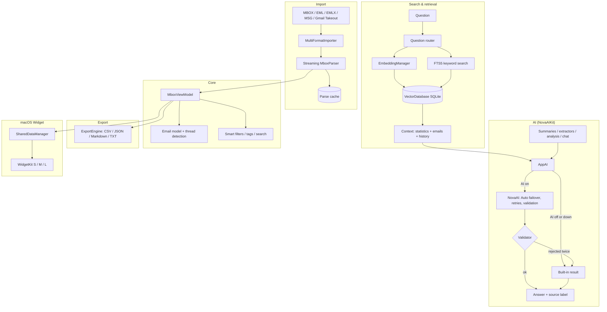
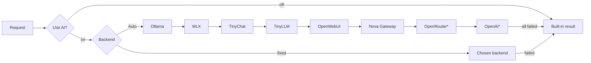

# MBox Explorer


**Email archive explorer for macOS: multi-format import, threaded browsing, semantic search, and optional AI
(Ask, summaries, extraction, analysis) that always has a built-in fallback.**

MBox Explorer parses MBOX, EML, EMLX, MSG and Gmail Takeout archives into a fast, searchable, threaded interface.
On top of that sit a retrieval-augmented "Ask" pipeline, AI summaries and a set of analysis tools. AI is powered by
[NovaAIKit](https://github.com/kochj23/NovaAIKit), the shared AI layer of Jordan's macOS apps: local backends
first, Keychain-only keys, and a built-in (non-AI) result for every feature when AI is off or unreachable.

Written by Jordan Koch.

---

## Architecture



### AI backends and failover



`*` keyed backends join the chain only when a key is stored in the Keychain; keys are only ever sent over https.

---

## Features

### Email parsing and browsing

| Capability | Details |
|---|---|
| Formats | MBOX, EML, EMLX, Outlook MSG, Gmail Takeout ZIP |
| Streaming parser | One email per `From ` boundary, peak memory about one message; honors mbox `>From ` quoting |
| Parse cache | Keyed by path + size + mtime; reopening an unchanged archive is near-instant |
| Auto-reopen | The last archive reopens on launch; indexing is resumable and cancellable |
| Threads | Message-ID / In-Reply-To / References |
| Filters and search | Smart filters, saved searches, regex search, command palette, quick open |
| Tools | Duplicate finder, attachment browser, PII redaction, mailbox merger, tags and collections, email diff |

### AI (NovaAIKit)

Settings › AI (or the gear next to the AI status dot in the toolbar):

- **Use AI** on/off. Off means nothing is sent anywhere and every feature uses its built-in result.
- **Backend**: Auto (Ollama → MLX → TinyChat → TinyLLM → OpenWebUI → Nova Gateway → OpenRouter → OpenAI), or one
  fixed backend. Per-backend URL and model (listed from the server), timeout, **Test connection**.
- **Keys** (OpenRouter, OpenAI, optional OpenWebUI) go only to the macOS Keychain under
  `com.jkoch.mboxexplorer.<backend>`; a stored key shows as "stored", never as text.
- **Status indicator** (toolbar, Ask, Conversations): green online with backend and model, orange offline, grey off;
  click to re-check.
- **Validation**: replies are cleaned of reasoning blocks, must be non-empty and length-capped; summaries and
  statistics answers are rejected if they contain figures that are not in the emails. A rejected reply is re-asked
  once, then the built-in result is used.

| Feature | With AI | Built-in result (AI off / unreachable / rejected) |
|---|---|---|
| Summarize email / thread | 2-4 sentence summary, labelled with its source | First lines of the message, with the reason |
| Ask (RAG Q&A) | Answer grounded in mailbox statistics and retrieved emails, with citations | The reason plus the top matching emails |
| Conversations | Multi-turn chat over the archive with citations and follow-ups | The reason plus the matching emails (cited) |
| Action items, meetings, natural-language filter, topic labels | Parsed from the AI reply | Keyword/rule results or empty |
| Digests, person profiles, executive summary | AI narrative plus computed statistics | Computed statistics with a short "AI unavailable" note |
| Smart replies, follow-ups, meeting responses | Drafted by AI | Templates |
| Persona chat, hypotheticals, time travel, decisions, commitments, relationships, drafts, forwarding, daily briefing | AI analysis | The analysis says why AI was not used; rule-based parts still run |

### Semantic search (embeddings)

Embeddings are separate from chat AI (Settings › AI › Semantic Search). Keyword (FTS5) search always works.

| Provider | Type | Notes |
|---|---|---|
| Ollama | Local | Uses the Ollama URL from the AI settings |
| Balanced (all local models) | Local | Round-robins bulk indexing across every local Ollama model |
| MLX | Local | Apple Silicon |
| Sentence Transformers | Local | `pip install sentence-transformers` |
| TinyChat / OpenWebUI | Local / self-hosted | OpenAI-compatible endpoints; OpenWebUI key in the Keychain |
| OpenAI | Cloud | Uses the OpenAI key from the AI settings (Keychain) |

### Analysis, export and visualization

- Sentiment dashboard (NaturalLanguage), phishing/threat detection, email forensics, relationship map
- Export: TXT, CSV, JSON, Markdown, per email or per thread, AI-ready chunked export, contacts (vCard/CSV)
- Spotlight indexing, Quick Look, follow-up notifications
- Statistics dashboard (Swift Charts), network graph, timeline, heatmap, word cloud

### macOS widget and Nova API

- WidgetKit small/medium/large widgets; data shared through App Group `group.com.jkoch.mboxexplorer`.
- Loopback-only status API on port **37434**: `curl http://127.0.0.1:37434/api/status`.

---

## Requirements

- macOS 14.0 or later
- For AI: any one backend, e.g. Ollama (`brew install ollama && ollama pull qwen3:8b`). Everything works without AI.

## Installation

### From DMG

1. Open `MBox Explorer-v2.4.0-build4.dmg` and drag **MBox Explorer** onto **Applications**.
2. Local builds are ad hoc signed. If macOS blocks the first launch: System Settings › Privacy & Security ›
   **Open Anyway** (or `xattr -dr com.apple.quarantine "/Applications/MBox Explorer.app"`).

Developer-ID signed, notarized releases are produced by `scripts/release.sh` (see [RELEASE.md](RELEASE.md)).

### From source

Requires Xcode 16 or later and the Metal Toolchain (for the MLX dependency):

```bash
xcodebuild -downloadComponent MetalToolchain
git clone git@github.com:kochj23/MBox-Explorer.git
cd MBox-Explorer
open "MBox Explorer.xcodeproj"     # resolves NovaAIKit, mlx-swift, mlx-swift-lm
```

## Usage

1. Open an archive (File › Open).
2. Browse in list, three-column, timeline, heatmap or network view.
3. Optionally index emails for semantic search, then use **Ask** or **Conversations**.
4. Use **Summarize** in the email detail toolbar; the sheet shows whether the summary came from AI or is built-in.

---

## Tests

199 tests, all passing, including `AIKitAdoptionTests` in seven categories (security, performance, retry, unit,
integration, functional, frame/UI state). AI tests use in-memory settings and key stores and a local URL protocol:
no Keychain or network access.

```bash
xcodebuild -project "MBox Explorer.xcodeproj" -scheme "MBox Explorer" -destination "platform=macOS" test
```

---

## Security and privacy

- Local-first: Ollama/MLX/TinyChat/TinyLLM/OpenWebUI run on your machine or LAN; cloud backends are opt-in.
- API keys only in the macOS Keychain (`com.jkoch.mboxexplorer.*`), only sent over https.
- Upgrading from 2.3 or earlier migrates once: old settings are imported; plaintext OpenAI keys (UserDefaults or
  `cloud_credentials.json`) move to the Keychain and the plaintext copies are deleted; secrets of the removed
  Google Cloud / Azure / AWS / IBM backends are deleted.
- Parameterized SQL everywhere; loopback-only API server; no telemetry.

## Changelog

See [CHANGELOG.md](CHANGELOG.md). 2.4.0: AI migrated to NovaAIKit 1.0.0.

## License

MIT License, Copyright 2026 Jordan Koch. See [LICENSE](LICENSE).

---

Written by Jordan Koch ([@kochj23](https://github.com/kochj23))
